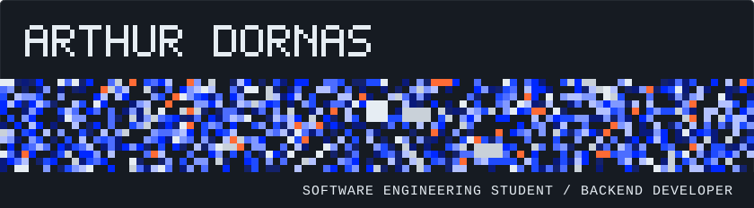
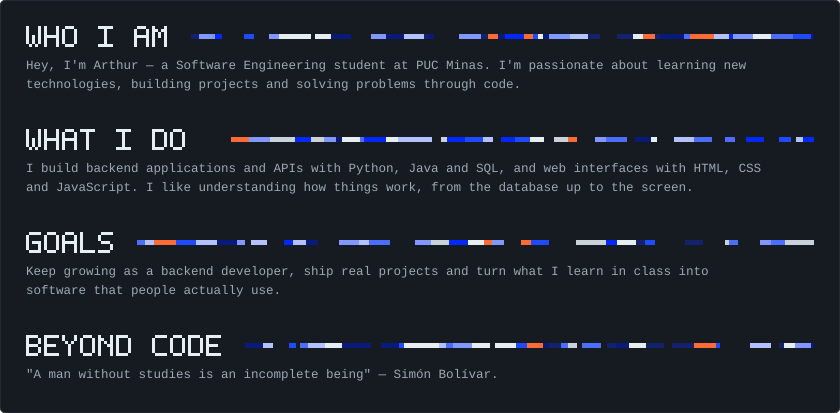
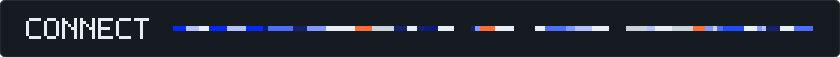
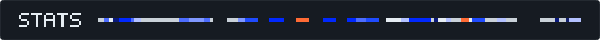
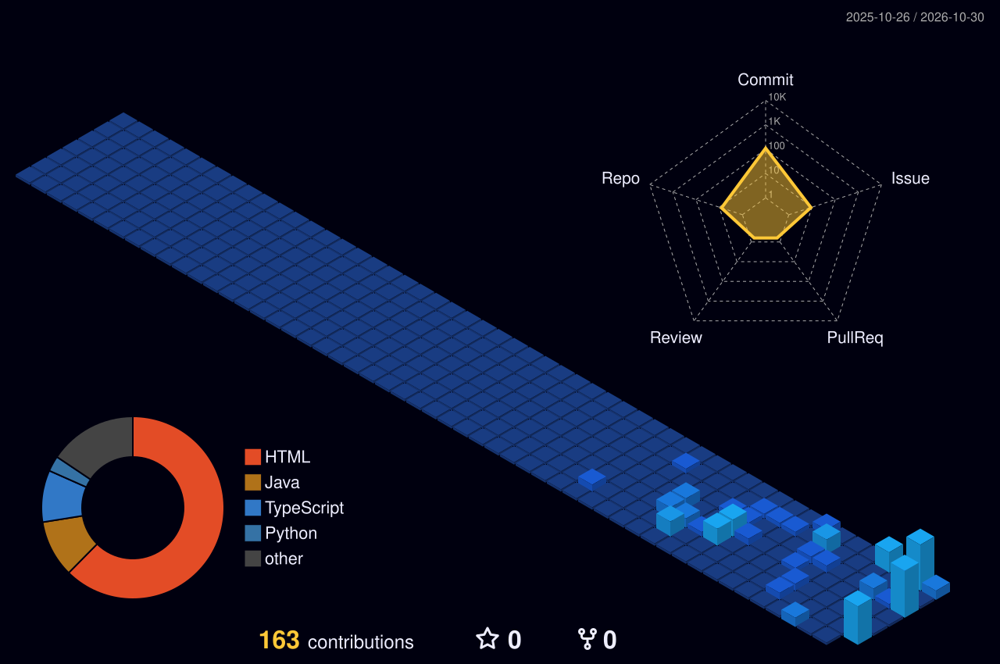
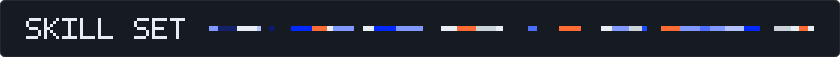

  

  

  

<table>
  <tr>
    <td align="center" width="140"><b>LinkedIn</b></td>
    <td align="center" width="140"><b>Gmail</b></td>
    <td align="center" width="140"><b>Instagram</b></td>
  </tr>
  <tr>
    <td align="center">
      
    </td>
    <td align="center">
      
    </td>
    <td align="center">
      
    </td>
  </tr>
</table>

  

  
    
  

