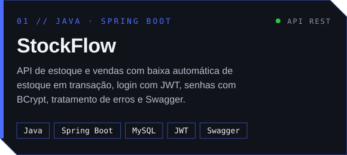
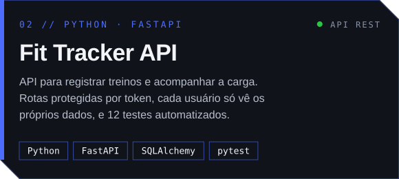
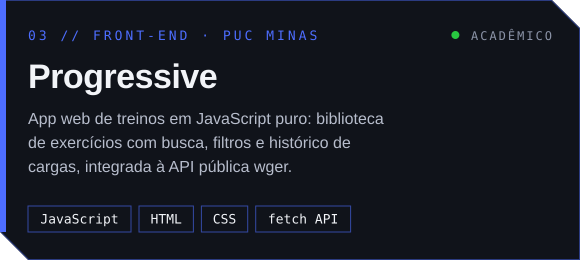
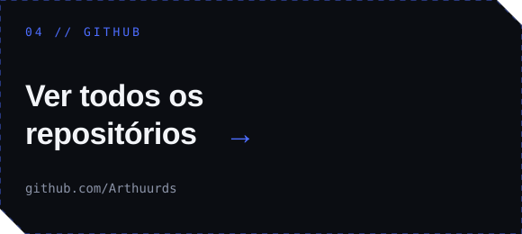

<p align="center">
  <a href="https://www.linkedin.com/in/arthur-dornas/"></a>
  <a href="mailto:arthurdornas1@gmail.com"></a>
  <a href="https://github.com/Arthuurds?tab=repositories"></a>
</p>

<br />


Estudante de **Engenharia de Software na PUC Minas** e do **Técnico em Desenvolvimento de Sistemas no Senac**. Gosto de construir **APIs REST** bem organizadas, com regras de negócio, autenticação e testes, e estou em busca do meu **primeiro estágio em desenvolvimento**.

```java
var arthur = new Desenvolvedor(
    "Arthur Dornas",
    "Estudante de Engenharia de Software @ PUC Minas",
    List.of("Java + Spring Boot", "Python + FastAPI", "MySQL"),
    "testes automatizados e segurança de APIs",   // estudando agora
    "Belo Horizonte, MG · presencial, híbrido ou remoto"
);
```

<br />


<table>
  <tr>
    <td width="50%"><a href="https://github.com/Arthuurds/StockFlow-Java"></a></td>
    <td width="50%"><a href="https://github.com/Arthuurds/api-fit-tracker"></a></td>
  </tr>
  <tr>
    <td width="50%"><a href="https://github.com/Arthuurds/progressive"></a></td>
    <td width="50%"><a href="https://github.com/Arthuurds?tab=repositories"></a></td>
  </tr>
</table>

<br />


<p align="center">
  <br />
  <br />
  
</p>

<br />


| Formação | Cursos complementares |
|---|---|
| **Bacharelado em Engenharia de Software** · PUC Minas · conclusão em 2030 | **Programação em Python e Java** |
| **Técnico em Desenvolvimento de Sistemas** · Senac · conclusão em 2027 | **Análise de Dados no Power BI** |
| | **Fundamentos de TI: Hardware e Software** |
| | **Inglês** · intermediário, em andamento |

<br />


<p align="center">
  
</p>

<picture>
  <source media="(prefers-color-scheme: dark)" srcset="https://raw.githubusercontent.com/Arthuurds/Arthuurds/output/snake-dark.svg" />
  
</picture>

<br />


<p align="center">
  Tem uma vaga de estágio ou um projeto para conversar? Me chama.<br /><br />
  <a href="https://www.linkedin.com/in/arthur-dornas/"></a>
  <a href="mailto:arthurdornas1@gmail.com"></a>
  <a href="https://www.instagram.com/arthuurds/"></a>
</p>
